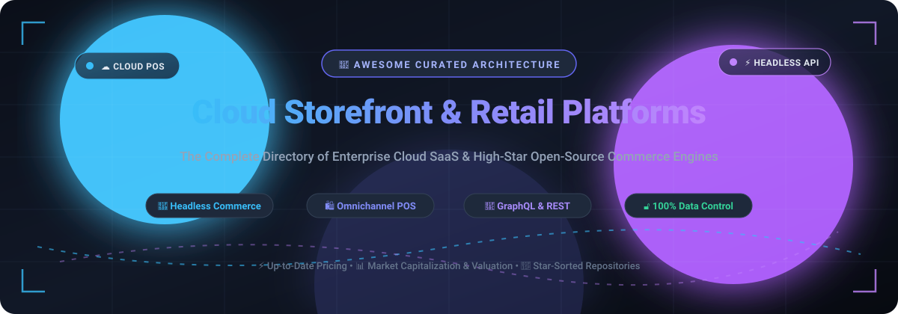

<p align="center">
  
</p>

# 🛒 Awesome Cloud Storefront & Retail Platform Ecosystem

[](https://awesome.re)
[](LICENSE)
[](CONTRIBUTING.md)
[](#-table-of-contents)

> 🌐 **A comprehensive, SEO-optimized curated directory of cloud storefront platforms, omnichannel retail operating systems, headless e-commerce frameworks, and self-hosted open-source shopping cart engines.**

---

## 📑 Table of Contents
- [📌 Sector Overview & Market Dynamics](#-sector-overview--market-dynamics)
- [☁️ Top SaaS & Hosted Cloud Retail Platforms](#️-top-saas--hosted-cloud-retail-platforms)
- [⭐ High-Star Open-Source Commerce Repositories](#-high-star-open-source-commerce-repositories)
- [🏗️ Architectural Archetypes & Choosing a Stack](#️-architectural-archetypes--choosing-a-stack)
- [🤝 How to Contribute](#-how-to-contribute)
- [🔒 Security & Production Best Practices](#-security--production-best-practices)
- [📜 Disclaimer & Notes](#-disclaimer--notes)

---

## 📌 Sector Overview & Market Dynamics

The global **e-commerce platform market** is valued at approximately **$7.97 billion in 2026** and is projected to expand to **$20.17 billion by 2034**, recording a compound annual growth rate (**CAGR of 12.3%**). Under broader categorizations that encompass enterprise digital experience architectures, omnichannel order management systems (OMS), and composable commerce backbones, the **digital commerce platform market** stands at **$16.75 billion in 2026** and is forecast to reach **$30.5 billion by 2030** (**16.2% CAGR**).

### 📊 Market Concentration & Fragmentation Analysis
* **Concentrated SaaS Tier**: The hosted storefront tier displays heavy winner-take-all concentration at the top. **Shopify** commands approximately **46% of the U.S. and multi-tenant e-commerce platform market share** in 2026, serving over 2 million merchants with quarterly GMV surpassing $120B+. Enterprise requirements are dominated by cloud giants like **Adobe (Adobe Commerce / Magento)**, **Salesforce (B2C & B2B Commerce)**, and **BigCommerce**.
* **Fragmented Open-Source & Headless Long-Tail**: Despite SaaS market consolidation, the overall retail software sector remains **moderately fragmented** due to strong merchant appetite for data ownership, lower transaction fees, and headless/composable flexibility. Next-generation open-source frameworks (**Medusa**, **Bagisto**, **Saleor**, **Vendure**, **Spree**) and veteran foundations (**WooCommerce**, **PrestaShop**, **OpenCart**) power millions of independent stores worldwide.

---

## ☁️ Top SaaS & Hosted Cloud Retail Platforms

The table below lists the primary managed cloud storefronts and retail software suites, ranked in **descending order by company scale** (market capitalization or corporate valuation).

| SaaS Platform | Company Scale (Valuation / Revenue) | Starting Price (Strictly Verified) | Free Tier / Free Trial Limits | Key Capabilities & Target Audience |
|:--------------|:------------------------------------|:-----------------------------------|:------------------------------|:-----------------------------------|
| **[Adobe Commerce](https://business.adobe.com/products/magento/magento-commerce.html)** | **~$220B+ Market Cap** (Adobe Inc., FY2025 Digital Experience rev: ~$5.5B) | **Quote-only** (Starting tier typically ~$1,833/month / $22,000/year based on GMV tiers) | **No permanent free tier**; interactive sandbox demo available via sales team | Enterprise-grade B2B/B2C commerce suite (formerly Magento Enterprise) featuring native multi-brand & AI merchandising. |
| **[Shopify](https://www.shopify.com/)** | **~$125B+ Market Cap** (Shopify Inc., FY2025 Revenue: ~$8.8B+) | **$39/month** (Basic plan, billed monthly; $29/mo billed annually) | **3-day full-feature free trial**, followed by a **$1/month promotional period for first 3 months**; no permanent free plan | Category-defining cloud retail OS with integrated payments, unified POS, fulfillment networks, and headless storefront SDKs. |
| **[Wix eCommerce](https://www.wix.com/)** | **~$11B+ Market Cap** (Wix.com Ltd., FY2025 Revenue: ~$1.75B+) | **$29/month** (Core plan, billed annually) | **14-day free trial** with full checkout preview; free forever website builder available, but online store checkout is disabled | Visual storefront builder with integrated multi-channel sales (Amazon/eBay/TikTok), inventory tracking, and payment processing. |
| **[Zoho Commerce](https://www.zoho.com/commerce/)** | **~$5B+ Valuation** (Zoho Corp., FY2025 Revenue: ~$1.4B+) | **$22/month** (Starter tier billed annually, or $27 billed monthly) | **15-day free trial** with complete access to all store features; no permanent free storefront tier | Native integration into the Zoho business ecosystem (Zoho Books, CRM, Inventory, Analytics, and Desk). |
| **[Squarespace Commerce](https://www.squarespace.com/)** | **~$7.2B Valuation** (Acquired by Permira in 2024; FY2025 rev: ~$1.1B+) | **$23/month** (Business plan, billed annually; 3% transaction fee) or **$28/month** (Basic Commerce, 0% transaction fee) | **14-day full-feature free trial** (extendable by 7 days upon request); no permanent free store plan | Design-forward storefront templates optimized for independent creators, boutique lifestyle brands, and portfolio commerce. |
| **[Shift4Shop](https://www.shift4shop.com/)** | **~$6B+ Market Cap** (Shift4 Payments Inc., FY2025 gross rev: ~$3.2B+) | **$0/month** (Free End-to-End plan using Shift4 payments) or **$29/month** (Basic Store with external gateways) | **Permanent Free Tier** (100% free when using Shift4 Merchant Services processing at least $500/mo); 15-day free trial on standalone plans | Turnkey storefront solution featuring unlimited products, zero bandwidth fees, built-in fraud prevention, and integrated payment processing. |
| **[WooCommerce Hosted (Woo.com / Automattic)](https://woocommerce.com/)** | **~$3B Valuation** (Automattic Inc., estimated parent valuation) | **$3.95/month** (Woo Express promotional starter, renewing at $39/mo) | **14-day free trial** on managed Woo Express cloud hosting; open-source self-hosted plugin remains permanently free | Fully managed cloud WordPress hosting with pre-configured WooCommerce, store themes, and automated maintenance. |
| **[BigCommerce](https://www.bigcommerce.com/)** | **~$600M Market Cap** (BigCommerce Holdings, FY2025 GMV: ~$31.7B) | **$39/month** (Standard plan, billed monthly; $29/mo billed annually) | **15-day full-feature free trial**; no permanent free tier | Open-SaaS architecture specializing in multi-storefront, wholesale B2B quoting, zero transaction fees, and headless Catalyst APIs. |
| **[Ecwid by Lightspeed](https://www.ecwid.com/)** | **~$1.6B Market Cap** (Lightspeed Commerce Inc., acquired for ~$500M) | **$19/month** (Venture plan billed annually, or $25 billed monthly) | **Permanent Free Tier**: Up to 5 catalog items, 2 categories, responsive cart, and tax calculation; 14-day free trial on higher plans | Modular shopping cart widget embeddable into any existing CMS (WordPress, Webflow, Notion, social channels, or mobile apps). |

---

## ⭐ High-Star Open-Source Commerce Repositories

The repositories below offer developer-friendly, self-hosted, or headless commerce backends and storefronts. **Sorted strictly in descending order of GitHub star counts.**

| Repository | GitHub Star Badge | Core Architecture / Tech Stack | Primary Focus & Highlights |
|:-----------|:------------------|:-------------------------------|:---------------------------|
| **[Medusa](https://github.com/medusajs/medusa)** | [](https://github.com/medusajs/medusa/stargazers) | Node.js, TypeScript, PostgreSQL, Redis | Modular, composable headless engine designed as an open-source alternative to Shopify. Highly extensible through custom plugins, workflows, and modules. |
| **[Bagisto](https://github.com/bagisto/bagisto)** | [](https://github.com/bagisto/bagisto/stargazers) | PHP, Laravel, MySQL, Vue.js | Enterprise-ready e-commerce and multi-vendor marketplace platform capable of handling 10M+ SKUs, multi-locale, and GraphQL headless commerce. |
| **[Saleor](https://github.com/saleor/saleor)** | [](https://github.com/saleor/saleor/stargazers) | Python, Django, GraphQL, PostgreSQL | High-performance, ultra-fast headless GraphQL API for global multi-channel and multi-currency enterprise digital commerce. |
| **[Spree Commerce](https://github.com/spree/spree)** | [](https://github.com/spree/spree/stargazers) | Ruby on Rails, PostgreSQL, Next.js | Battle-tested full-stack & headless platform for DTC, B2B, and multi-vendor marketplaces with REST APIs and ready-to-deploy Next.js storefront. |
| **[Magento 2 Open Source](https://github.com/magento/magento2)** | [](https://github.com/magento/magento2/stargazers) | PHP, Elasticsearch, Redis, MySQL, Varnish | Industrial-grade self-hosted open-source foundation backing tens of thousands of complex global stores; massive module ecosystem. |
| **[Alokai (Vue Storefront)](https://github.com/vuestorefront/vue-storefront)** | [](https://github.com/vuestorefront/vue-storefront/stargazers) | TypeScript, Vue.js / Nuxt, React / Next.js | Frontend as a Service (FEaaS) and composable storefront framework connecting headless commerce APIs to blazing-fast customer-facing web apps. |
| **[WooCommerce Core](https://github.com/woocommerce/woocommerce)** | [](https://github.com/woocommerce/woocommerce/stargazers) | PHP, WordPress, MySQL, React | The world's most widely deployed open-source e-commerce platform, powering millions of stores with over 50,000+ plugins and theme extensions. |
| **[EverShop](https://github.com/evershopcommerce/evershop)** | [](https://github.com/evershopcommerce/evershop/stargazers) | Node.js, React, GraphQL, PostgreSQL | Modern, modular full-stack JavaScript commerce engine offering built-in admin dashboard, responsive themes, and micro-frontend extensibility. |
| **[PrestaShop](https://github.com/PrestaShop/PrestaShop)** | [](https://github.com/PrestaShop/PrestaShop/stargazers) | PHP, Symfony, MySQL, Smarty/Twig | European commerce cornerstone providing complete turnkey storefronts, order workflows, international tax engines, and module marketplace. |
| **[Vendure](https://github.com/vendurehq/vendure)** | [](https://github.com/vendurehq/vendure/stargazers) | TypeScript, NestJS, GraphQL, SQLite / PostgreSQL | Modern developer-first headless framework built on NestJS and GraphQL, optimized for custom business rules, microservices, and speed. |
| **[Sylius](https://github.com/Sylius/Sylius)** | [](https://github.com/Sylius/Sylius/stargazers) | PHP, Symfony, API Platform, PostgreSQL / MySQL | Clean, test-driven commerce framework adhering to strict DDD (Domain-Driven Design), ideal for tailored B2B solutions and enterprise integrations. |
| **[OpenCart](https://github.com/opencart/opencart)** | [](https://github.com/opencart/opencart/stargazers) | PHP, MySQL, MVC-L | Lightweight, user-friendly self-hosted shopping cart system with multi-store management, low hosting resource footprint, and 13,000+ add-ons. |
| **[Solidus](https://github.com/solidusio/solidus)** | [](https://github.com/solidusio/solidus/stargazers) | Ruby on Rails, PostgreSQL | Fork of Spree Commerce engineered for high-volume retailers, complex fulfillment pipelines, custom subscription workflows, and enterprise agility. |
| **[Open Source Point of Sale](https://github.com/opensourcepos/opensourcepos)** | [](https://github.com/opensourcepos/opensourcepos/stargazers) | PHP, CodeIgniter, MySQL, Bootstrap | Web-based physical POS system with barcode scanning, cash register, customer rewards, inventory management, and receipt printing. |
| **[Shopware 6](https://github.com/shopware/shopware)** | [](https://github.com/shopware/shopware/stargazers) | PHP, Symfony, Vue.js, MySQL | Leading European open-commerce platform with native CMS "Shopping Experiences", Rule Builder, Flow Builder, and headless API-first architecture. |
| **[Shuup](https://github.com/shuup/shuup)** | [](https://github.com/shuup/shuup/stargazers) | Python, Django, PostgreSQL | Multi-vendor marketplace and complex B2B e-commerce platform with modular product attributes, contact pricing, and merchant portals. |

---

## 🏗️ Architectural Archetypes & Choosing a Stack

```
   ┌─────────────────────────────────────────────────────────────┐
   │             Digital Retail Architecture Spectrum            │
   └─────────────────────────────────────────────────────────────┘

  Turnkey All-in-One SaaS       Headless Composable        Self-Hosted Open Source
  ┌─────────────────────┐      ┌────────────────────┐     ┌─────────────────────┐
  │  Shopify / BigComm  │      │ Medusa / Saleor    │     │ WooCommerce / Spree │
  │  Squarespace / Wix  │ ───► │ + Next.js / Alokai │ ──► │ Bagisto / PrestaShop│
  │                     │      │ + Headless CMS     │     │                     │
  │  • Zero DevOps      │      │ • Front/Back Decoup│     │ • Full Data Sovereig│
  │  • Platform fees    │      │ • Infinite UX      │     │ • Self-managed Infra│
  └─────────────────────┘      └────────────────────┘     └─────────────────────┘
```

1. **Turnkey SaaS (Fast Time-to-Market)**: Best suited for brands prioritizing marketing and product development over backend engineering. Lower operational burden, managed PCI compliance, but recurring transaction fees.
2. **Headless Composable Commerce (Enterprise Agility)**: Ideal for fast-scaling DTC brands wanting custom web/mobile frontend experiences (React, Next.js, Vue) backed by robust APIs (**Medusa**, **Saleor**, **Vendure**).
3. **Turnkey Self-Hosted Open Source (Data Ownership)**: Ideal for organizations subject to strict data sovereignty, localized ERP workflows, or zero-margin tolerance for vendor SaaS lock-in (**Bagisto**, **WooCommerce**, **Sylius**).

---

## 🤝 How to Contribute

Contributions to this ecosystem are warmly encouraged!

1. 🍴 **Fork the repository** on GitHub.
2. 🌿 **Create a topic branch**: `git checkout -b feature/add-new-retail-platform`.
3. 📝 **Add or update the solution** in `README.md`:
   - Follow the established table schema (Name, Star Badge / Valuation, Pricing, Free tier limits, Description).
   - Verify that all URLs are canonical and pricing tiers reflect current vendor terms.
4. 🚀 **Submit a Pull Request** with a concise description of the addition.

---

## 🔒 Security & Production Best Practices

- 🛡️ **PCI DSS Compliance**: If processing payment cards directly, ensure adherence to SAQ-A or SAQ-A-EP requirements. Where possible, leverage hosted fields or payment element iframes (Stripe, Adyen, PayPal).
- 🔑 **Access Control & Admin Security**: Enforce Multi-Factor Authentication (MFA), role-based access control (RBAC), and IP allowlisting for all administrative consoles.
- 📦 **Data Sovereignty & Encryption**: Encrypt all customer PII both at rest (AES-256) and in transit (TLS 1.3). Regularly test database backup recovery pipelines.

---

## 📜 Disclaimer & Notes

* ℹ️ This repository is a community-driven curated directory maintained for educational and reference purposes. It does not constitute commercial endorsement or affiliate sponsorship.
* 💲 SaaS pricing and free trial configurations change periodically; merchants must confirm current tier terms directly with vendor pricing pages before committing.
* 🛠️ Self-hosted open-source software shifts infrastructure scaling, security updates, and database maintenance to the hosting organization.

---

<p align="center">
  <b>Built with ❤️ for e-commerce architects, retailers, and developers worldwide.</b><br>
  <sub>⭐ Star this repository if it helps you evaluate or build your cloud storefront stack!</sub>
</p>
